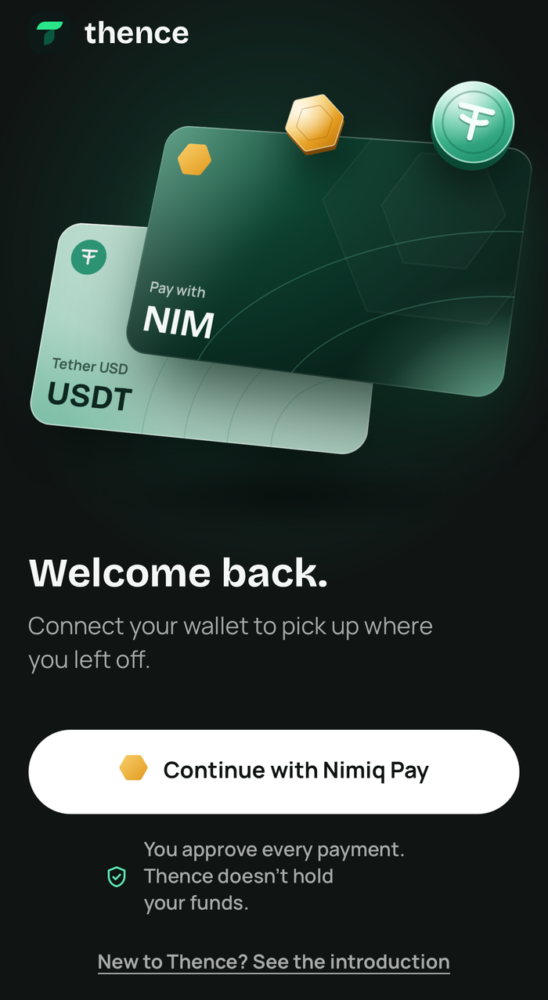
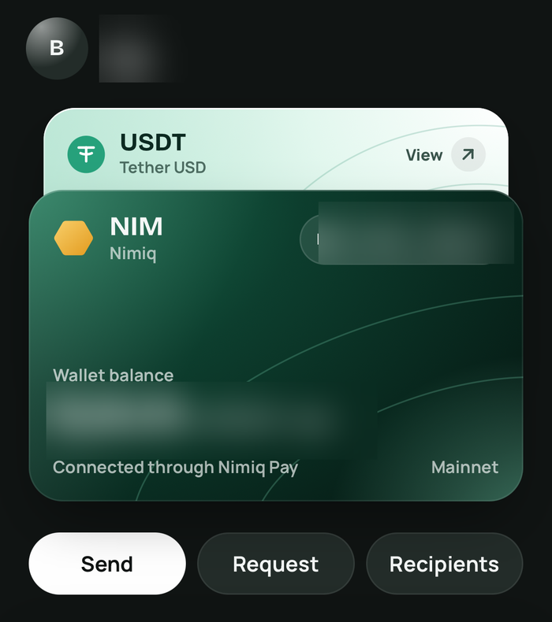
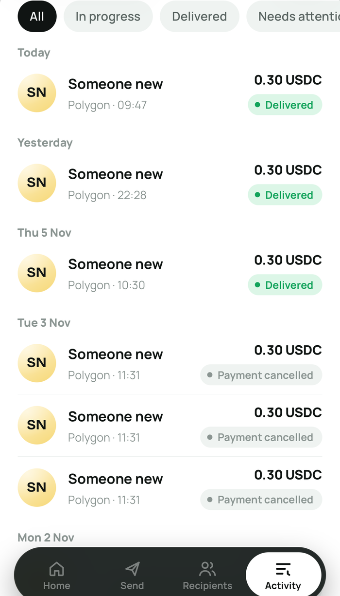
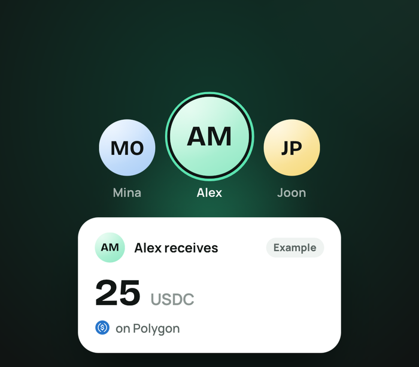
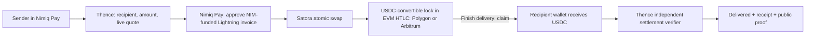

<div align="center">
  
  <h1>Thence</h1>
  <h3>Your NIM can go further.</h3>
  <p><strong>Recipient-first cross-chain payments, powered by Nimiq.</strong></p>
  <p>Pay with NIM. Your recipient receives USDC on a supported blockchain.</p>
  <p>
    <a href="https://paywiththence.cv"><strong>▶ Launch Thence</strong></a>
    <br/>
    <sub>Open it inside <strong>Nimiq Pay</strong>. The direct Nimiq Pay directory link (<code>nimpay.app/miniapps/open/paywiththence.cv</code>) goes live once Thence is listed in the Mini App catalog.</sub>
  </p>
  <p>
    <a href="https://paywiththence.cv">Official website</a> ·
    <a href="https://github.com/kaelah971/thence">Source code</a> ·
    <a href="docs/hackathon/EVIDENCE.md">Payment evidence</a> ·
    <a href="https://paywiththence.cv/api/proofs">Live proofs feed</a> ·
    <a href="docs/ARCHITECTURE.md">Architecture</a>
  </p>
  <!-- Add "Watch the demo" here once the published Thence video URL exists. Do not use a placeholder link. -->
  <p><code>Nimiq Cycle 3 Mini App Competition</code> · <code>Pay category</code> · <code>Live mainnet payments</code> · <code>MIT licensed</code></p>
</div>

---

## Judge quick start

| | |
|---|---|
| **1. Open the app** | [paywiththence.cv](https://paywiththence.cv) inside **Nimiq Pay** (it uses the real Nimiq Pay wallet; a normal browser can't approve payments). |
| **2. See real deliveries** | [Live proofs feed](https://paywiththence.cv/api/proofs): **9 verified NIM-funded USDC deliveries on mainnet: 8 on Polygon and 1 on Arbitrum**, each checked on-chain at finality. |
| **3. Read the evidence** | [Capability-by-capability evidence](docs/hackathon/EVIDENCE.md) · [first mainnet delivery](docs/PILOT_2026-11-05_FIRST_DELIVERY.md). |
| **4. Check the Nimiq integration** | [Mini Apps SDK calls used in the payment path](#real-nimiq-pay-integration), with source links. |
| **5. Check the engineering** | [Architecture](docs/ARCHITECTURE.md) · [state-machine atlas](docs/architecture/STATE_MACHINE_ATLAS.md) · [reliability work in progress](#reliability-and-security-engineering). |

**Current status:** both routes are live and **demonstrated with real mainnet deliveries**. On 2026-11-17, controlled tests through the hardened claim path delivered USDC on **Polygon** and, for the first time, on **Arbitrum** ([details](#supported-chains-and-current-status)).

## What is Thence?

Thence is a **recipient-first payment Mini App inside Nimiq Pay**. You start with the person you're paying: their wallet, their network and the amount **they** should receive. Thence then quotes the cost, you approve once in Nimiq Pay with NIM, and Thence follows the payment until the USDC has been verified in the recipient's wallet.

### The problem: your money shouldn't stop at your blockchain

Imagine holding **NIM** but needing to pay someone who uses **USDC on Polygon or Arbitrum**. The recipient doesn't want to open a Nimiq wallet just to get paid. The sender shouldn't have to become an expert in swaps, bridges, networks, fees and wallet compatibility.

Thence closes that gap: **the sender pays with what they hold; the recipient receives an explicitly supported asset on the chain they use.**

## See the actual app

<table>
  <tr>
    <td width="33%" align="center"></td>
    <td width="33%" align="center"></td>
    <td width="33%" align="center"></td>
  </tr>
  <tr>
    <td align="center"><strong>01 · Connect</strong><br/>Continue with Nimiq Pay</td>
    <td align="center"><strong>02 · Pay</strong><br/>NIM wallet and receiving route</td>
    <td align="center"><strong>03 · Verify</strong><br/>Delivery history and status</td>
  </tr>
</table>

<p align="center"><em>Real Thence screenshots from mobile testing. Wallet details in the second image are blurred for privacy. The activity list includes delivered and cancelled attempts; it is not a staged success screen. The NIM and USDT cards show the assets a Nimiq Pay wallet holds; Thence delivers <strong>USDC</strong>, not USDT.</em></p>

<details>
<summary><strong>More product UI: recipient-first payment experience</strong></summary>
<br/>
<p align="center"></p>
<p align="center"><em>In-app illustration, not a separate live route.</em></p>
</details>

## How a payment works

1. **Choose the recipient and the amount they receive.** Pick a saved recipient or enter a wallet, its network (Polygon or Arbitrum) and the USDC amount. You can also send someone a **shareable payment request**.
2. **Review a live quote.** Thence asks the swap provider for an *exact-receive* quote and shows the terms and expiry. It never invents a price when no live quote is available.
3. **Approve once in Nimiq Pay.** Nimiq Pay shows the exact NIM amount and you authorize the NIM-funded Lightning payment in the real wallet.
4. **Finish delivery.** A [Satora](https://satora.io) atomic swap locks USDC-convertible funds in a hash-time-locked contract (HTLC) on the destination chain. Once that funding is final, one **Finish delivery** tap releases it to the recipient. Only your device holds the secret that does this.
5. **Verified, with a receipt.** Thence marks the payment **Delivered** only after it independently verifies the USDC transfer to the recipient on-chain, at finality. Activity and the receipt keep the proof.

No exchange account, bridge or manual swap for the sender. This does **not** mean every network is supported or that payments are fee-free or instant.

## Features and user experience

| Feature | Status in production |
|---|---|
| Connect and sign in with the Nimiq Pay wallet (wallet-signed authentication) | **Deployed** |
| NIM balance on Home | **Deployed** |
| Recipient-first payments with live exact-receive quotes | **Deployed** |
| Saved recipients and shareable payment requests | **Deployed** |
| NIM-funded Lightning payment through Nimiq Pay, Satora atomic swap | **Deployed** |
| One-tap Finish delivery, live progress timeline, activity and receipts | **Deployed** |
| Independent on-chain delivery verification and a public proofs feed | **Deployed** |
| Short-delivery reporting (exact received vs requested) | **Deployed** |
| Refund recognition, NIM-return verification, server reconciliation, emergency stop | **Deployed** |
| Arbitrum claim hardening, claim diagnostics, stricter delivery proofs ([#84](https://github.com/kaelah971/thence/pull/84), [#85](https://github.com/kaelah971/thence/pull/85)) | **Deployed** (2026-11-17) |

## Real Nimiq Pay integration

| Mini Apps SDK capability | What Thence does | Implementation |
|---|---|---|
| `init()` | Connect to the injected Nimiq Pay provider | [`src/ui/lib/nimiq-provider.ts`](src/ui/lib/nimiq-provider.ts) |
| `listAccounts()` | Select the payer's wallet | [`src/ui/lib/wallet-diagnostics.ts`](src/ui/lib/wallet-diagnostics.ts) |
| `sign()` | Wallet-backed authentication | [`src/ui/lib/auth-client.ts`](src/ui/lib/auth-client.ts) |
| `getBalance()` | Show NIM funds on Home | [`src/ui/lib/balance.ts`](src/ui/lib/balance.ts) |
| `payLightningInvoice()` | Pay the authorized swap invoice with NIM | [`src/ui/lib/nimiq-pay.ts`](src/ui/lib/nimiq-pay.ts) |

This is wallet and payment infrastructure in the actual transaction path, not just Nimiq branding. Thence also verifies the NIM funding transaction on the Nimiq chain independently.

## Supported chains and current status

| | **USDC on Polygon** | **USDC on Arbitrum** |
|---|---|---|
| Implemented | ✅ | ✅ |
| Enabled in production | ✅ | ✅ |
| Delivered on mainnet | ✅ **8 verified deliveries** ([proofs](https://paywiththence.cv/api/proofs)) | ✅ **1 verified delivery** (2026-11-17, [proofs](https://paywiththence.cv/api/proofs)) |
| Simulated end-to-end tests | ✅ | ✅ (claim path through the real installed SDK, no money) |
| Hardened claim path (#84/#85) run live | ✅ 2026-11-17, delivered 0.300158 USDC for 0.30 requested | ✅ 2026-11-17, delivered 0.301553 USDC for 0.30 requested |

**How Arbitrum got to its first delivery:**
- The first attempt used a provider contract version that Thence did not yet trust, so Thence correctly refused to claim. That was fixed in [#83](https://github.com/kaelah971/thence/pull/83).
- The second attempt's in-browser claim never reached the chain. The exact browser error wasn't recorded at the time.
- In both cases the provider refunded its side. The payer's NIM returns through the Nimiq HTLC refund after its timeout.
- PRs #84/#85 made every claim attempt observable (which step failed, with codes, no secrets) and added the guards listed [below](#reliability-and-security-engineering).
- **2026-11-17, after the deploy:** the sponsored ERC-4337 claim was confirmed on Arbitrum seven seconds after the Finish delivery tap. Thence verified the USDC transfer at Ethereum (L1) finality about 20 minutes later. The payment is in the public proofs feed with its NIM source transaction verified.
- One earlier attempt that day was rejected inside Nimiq Pay before any NIM moved. It expired and was closed with no funds at risk.

USDT and other networks (Base, Ethereum) are **not enabled**. Network options in the Mini App framework don't mean Thence supports them.

## Verified mainnet transaction evidence

The proof is USDC reaching a recipient on-chain, not a green status label.

| Evidence | Details |
|---|---|
| **First mainnet payment (Nov 5, 2026)** | A Nimiq Pay-funded transfer delivered at least 0.30 USDC on Polygon. [Pilot report](docs/PILOT_2026-11-05_FIRST_DELIVERY.md). |
| **Public proofs feed** | [9 verified deliveries](https://paywiththence.cv/api/proofs) (Nov 6–17, 0.30 to 2.50 USDC): 8 on Polygon and 1 on Arbitrum. Each one was checked against the NIM source transaction on the Nimiq chain and the USDC transfer at destination-chain finality. |
| **Short delivery, reported honestly** | One delivery received 0.999556 of the 1.00 USDC requested. It is labelled `DELIVERED_SHORT` with both amounts, never as a full delivery ([R7](docs/R7_SHORT_DELIVERY.md)). |
| **Faster settlement (Nov 7)** | Polygon verification moved from 256 confirmations to the `finalized` block tag, with fail-closed guards ([details](docs/POLYGON_FINALITY.md)). |
| **Both routes after the hardening deploy (Nov 17)** | Controlled 0.30 USDC payments through the deployed #84/#85 claim path: **Polygon** via Satora's gasless relay (0.300158 USDC) and **Arbitrum** via a sponsored ERC-4337 UserOperation (0.301553 USDC). Both were verified at finality, with secret-free claim reports. |

Recipient addresses beyond the public proofs, payment hashes and secrets are not published. A successful payment is not a guarantee that every future payment completes without delay.

## Technical architecture



**How the two chains differ:**

| | Polygon (137) | Arbitrum (42161) |
|---|---|---|
| Claim mechanism | Satora gasless relay submits `redeemAndExecute` | Sponsored ERC-4337 UserOperation (EIP-7702 Kernel account, EntryPoint v0.7, Satora's bundler and paymaster) runs `redeemAndExecute` |
| Swap to USDC | Provider DEX leg inside the claim | Uniswap v3 leg inside the claim |
| Funding check before claim | 32 confirmations | Ethereum (L1) finality, about 20 minutes |
| Delivery verified at | Polygon `finalized` block | L1-finalized Arbitrum block |
| Pinned HTLC deployments | v6 | v6 and v7, each with its coordinator ([`HTLC_DEPLOYMENTS`](src/lib/settlement.ts)) |

**Stack:** Next.js 16, React 19, TypeScript, PostgreSQL with Drizzle, the Nimiq Mini Apps SDK, the Satora SDK, and viem.
- Money is handled in bigint atomic units.
- The server binds destination, chain, token, amount and HTLC terms before authorizing a claim.
- The swap secret stays on the user's device; Thence never holds customer funds.

**Key source:**
- Settlement verification: [`src/lib/settlement.ts`](src/lib/settlement.ts)
- Claim authorization: [`src/lib/claim-intent.ts`](src/lib/claim-intent.ts)
- Pre-payment HTLC checks: [`src/lib/htlc-preflight.ts`](src/lib/htlc-preflight.ts)
- Reconciliation: [`src/lib/reconcile.ts`](src/lib/reconcile.ts)
- Provider adapter: [`src/lib/satora.ts`](src/lib/satora.ts)
- In-browser claim: [`src/ui/lib/satora-browser.ts`](src/ui/lib/satora-browser.ts)
- Payment states: [`src/domain/transfers.ts`](src/domain/transfers.ts)

**Further reading:** [architecture](docs/ARCHITECTURE.md) · [state-machine atlas and defect register](docs/architecture/STATE_MACHINE_ATLAS.md) · [server reconciler](docs/SERVER_RECONCILER.md) · [payment recovery](docs/R8_PAYMENT_RECOVERY.md) · [NIM return](docs/R2_NIM_RETURN.md).

## Reliability and security engineering

The two failed Arbitrum attempts led to a systematic hardening effort. Both pull requests were **merged and deployed on 2026-11-17**, and the same day controlled payments on both chains delivered through the hardened path. The review so far has been **internal** (developer- and AI-assisted adversarial review), not an independent third-party audit.

| PR | Status | What it adds |
|---|---|---|
| [#84](https://github.com/kaelah971/thence/pull/84) | Merged and deployed · [all checks green](https://github.com/kaelah971/thence/actions/runs/44034672177) at `7a26fe9` | Claim paths must be proven before new payments use them. Claim outcomes are classified from evidence: submitted, not sent, or unknown. Secret-free claim diagnostics. Correct network wording. Finality waits that survive brief provider errors. |
| [#85](https://github.com/kaelah971/thence/pull/85) | Merged and deployed · [all six checks green](https://github.com/kaelah971/thence/actions/runs/44092025907), including browser E2E | Payment-integrity audit fixes, listed below. |

**Fixes in #85:**
- **Swap terms:** provider terms are bound before any NIM moves.
- **Delivery proof:** delivery requires the bound swap's redeem event.
- **Arbitrum finality:** it can't be weakened by configuration.
- **Recovery integrity:** checks run on the device before the secret is revealed.
- **Handoff:** duplicate-handoff and replay protection.
- **Attribution:** source-transaction attribution resists poisoning.
- **NIM returns:** source-refund and NIM-return closes require on-chain proof.
- **Minimum output:** a quote-bound minimum-output policy. ≥ 99% of the request proceeds automatically; 97–99% needs the payer's explicit confirmation of the exact amount; below that is refused.

**Engineering themes:**
- Contract and coordinator compatibility checks.
- Bound swap terms.
- Claim execution instrumentation.
- Source and destination verification.
- Failure classification.
- Browser recovery integrity.
- Refund and reconciliation safeguards.
- Adversarial and fault-injection tests that run the **real installed Satora SDK** without moving money.
- Full release-shard and browser E2E verification.

Green CI shows the application behaves correctly in simulation. On its own it is not proof of live payment execution; the live evidence is the controlled mainnet deliveries above.

## Testing and reproducibility

**Prerequisites:** Node.js 20+ and PostgreSQL 16+ ([setup guide](docs/LOCAL_DB.md)). Use a **separate development database**; never point local scripts at production.

```bash
git clone https://github.com/kaelah971/thence.git
cd thence
npm install
cp .env.example .env
# Configure a development PostgreSQL database as documented in docs/LOCAL_DB.md
npm run db:migrate
npm run dev
```

`http://localhost:3000/api/health` is the local health endpoint. For the real wallet experience, open the app inside Nimiq Pay through a properly configured HTTPS origin. Without Nimiq Pay, `/app/preview` is a clearly labelled **fictional, development-only** walkthrough. It is not payment evidence and doesn't exist in production.

```bash
npm run typecheck
npm run lint
npm test                 # requires an isolated THENCE_TEST_DATABASE_URL
npx playwright test      # browser E2E: Chromium desktop/mobile and WebKit/iPhone, simulated Nimiq Pay/Satora/chain
npm run build
```

Automated E2E tests use **simulated** providers and chains. The mainnet deliveries above are separate, real-payment evidence, and neither is presented as the other.

## Safety, limits and transparency

- **Routes:** USDC on Polygon and USDC on Arbitrum, both demonstrated on mainnet. Nothing else is enabled.
- **Payment approval:** Nimiq Pay asks the sender to authorize every payment; Thence never initiates one silently.
- **Exact receive, measured honestly:** quotes target the exact amount the recipient should receive. The final DEX execution can land slightly above or below it, within the provider's limits. Thence reports the amount measured on-chain, and anything below the request is labelled `DELIVERED_SHORT` with both amounts.
- **Time-sensitive delivery:** Finish delivery must happen before the provider's claim deadline (set when the swap is created). The app shows the time left, warns in the last 15 minutes and offers no claim in the last 5 ([`claim-deadline.ts`](src/domain/claim-deadline.ts)).
- **If delivery doesn't happen:** the provider refunds its side and the payer's NIM returns through the Nimiq HTLC refund after its timeout. Thence tracks and verifies both, but provider or network problems can delay resolution.
- **No false Delivered:** unavailable or inconsistent chain data never turns into a Delivered state.
- **Privacy:** don't post recipient addresses, secrets, invoice details or full logs publicly. Screenshots here redact private details.
- **Legal:** the [Privacy Policy](docs/legal/PRIVACY_POLICY.md) and [Terms](docs/legal/TERMS_OF_USE.md) are drafts, not finalized legal review.

Security details: [`SECURITY_REVIEW.md`](docs/SECURITY_REVIEW.md) · [`PUBLIC_RELEASE_AUDIT.md`](docs/PUBLIC_RELEASE_AUDIT.md) · [`RISK_IOS_WEBVIEW_STORAGE.md`](docs/RISK_IOS_WEBVIEW_STORAGE.md).

## Why this matters for Nimiq

Thence extends what holding NIM is good for. A Nimiq Pay user can pay someone who doesn't use Nimiq, and the recipient doesn't have to switch wallets. That makes it relevant for paying freelancers, friends or small service providers in other crypto ecosystems. This is a **use case**, not a claim of measured adoption.

<details>
<summary><strong>Where we saw the problem, before building</strong></summary>

| Evidence from the ecosystem | What it told us | The Thence response |
|---|---|---|
| [Nimiq forum: *The Future of Nimiq* (May–June 2025)](https://forum.nimiq.community/t/the-future-of-nimiq/2255): discussion of confusing multi-chain stablecoin transfers and network incompatibilities. | The receiving **network** matters, and cross-chain steps create friction for regular users. | Recipient-first destination selection, a live quote, explicit asset and network labelling, and a single payment journey. |
| [Nimiq Pay roadmap discussion (November 2025)](https://forum.nimiq.community/t/community-question-can-a-more-detailed-roadmap-be-shared-for-nimiq-pay/2366): EVM support and payment-aware swap mini apps as directions to explore. | Extending wallet utility through mini apps fits a stated ecosystem direction. | Build **inside Nimiq Pay**, using its real wallet and payment SDK. |
| [Nimiq USDC/Polygon testing thread (March 2023)](https://forum.nimiq.community/t/testing-usdc-support-in-the-nimiq-wallet/1878): NIM/USDC swapping already existed. | The innovation is not swaps themselves, but turning conversion plus sending into a payment experience. | Start with what the recipient must receive, authorize once, follow delivery, keep the receipt. |
| [Cycle III's Pay category](https://miniappscompetition.com/cycle3): extend how people use NIM and USDT to pay. | The bar is an app people can actually use. | A working mainnet payment route with recovery, status and on-chain verification. |

These are problem signals, not customer interviews or proof of product-market fit.
</details>

## Competition and documentation

Built for the **[Nimiq Mini Apps Competition — Cycle III](https://miniappscompetition.com/cycle3)**, in the **Pay** category.

- [Official competition rules](https://miniappscompetition.com/rules) · [judging criteria](https://miniappscompetition.com/scoring)
- [Capability-by-capability evidence](docs/hackathon/EVIDENCE.md)
- [Payment recording checklist](docs/hackathon/RECORDING_CHECKLIST.md)
- [Operations and deployment](docs/OPERATIONS.md)
- Project updates: [@usethence](https://x.com/usethence)

**Thence — Your NIM can go further.**

---

Licensed under [MIT](LICENSE). Third-party frameworks and artwork keep their own licenses; see [NOTICE](NOTICE.md).
