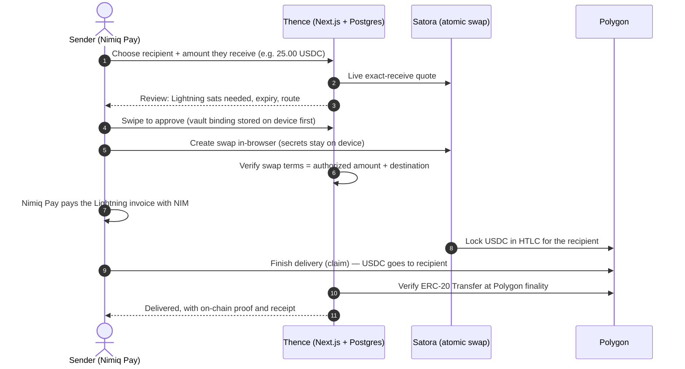

# Thence — pay in NIM, they receive stablecoins

> Pay from what you have. They receive what they use.

Thence is a **Nimiq Pay Mini App** (Nimiq Mini Apps Competition, Cycle III, **Pay** category).
The sender pays with **NIM** from Nimiq Pay. The recipient receives an **exact** amount of
**USDC** on their own wallet, without needing Nimiq, an exchange account or a bridge.

- **Recipient-first amounts.** You type what they should receive (for example 25.00 USDC). Thence
  quotes it live and binds the exact atomic amount from quote to on-chain proof.
- **One approval in Nimiq Pay.** Nimiq Pay pays a Lightning invoice with NIM. A Satora atomic swap
  turns it into USDC on Polygon. You tap **Finish delivery** once.
- **Delivered means proven.** Thence shows *Delivered* only after it has verified the ERC-20
  transfer on-chain with 256 Polygon confirmations, and links the proof.

## Verified on mainnet

On **2026-11-05**, a supervised mainnet payment delivered **0.30 USDC on Polygon** paid
with about **1,000 NIM** from Nimiq Pay. It took one approval, one claim and one on-chain transfer.
Thence recorded seven audited state transitions and stored a 256-confirmation settlement proof.

| Fact | Value |
|---|---|
| Route | `usdc-polygon`, target `300000` atomic (0.30 USDC) |
| Funding (provider HTLC) | Mined about 41 s after the quote |
| Delivery (claim) | Mined about 97 s after the quote; the recipient received ≥ the target |
| Finality | 256 confirmations (the policy then); proof stored as `evm_erc20_transfer` |
| Since then | Public payments live (2026-11-06); Delivered at Polygon finality, about 2 minutes end to end (2026-11-07) |

The full postmortem is in [`docs/PILOT_2026-11-05_FIRST_DELIVERY.md`](docs/PILOT_2026-11-05_FIRST_DELIVERY.md).
Wallets, transaction hashes, block numbers and exact on-chain amounts are deliberately omitted
for privacy. A
capability matrix, separating what is verified, implemented-but-off and planned, is in
[`docs/hackathon/EVIDENCE.md`](docs/hackathon/EVIDENCE.md).

> **Payment status.** Funded payments are controlled by an explicit payment mode
> (`off | pilot | public`) **and** a database emergency switch. **Public payments are live** in
> production (since 2026-11-06): any Nimiq Pay wallet can pay, and a payment takes about two
> minutes from approval to Delivered. Only the `usdc-polygon` route is enabled.

## How a payment works



If anything breaks before the claim, nothing is lost. The provider refunds its Polygon lock after
the claim deadline, the Lightning hold invoice is never settled, and Nimiq Pay returns the NIM.

## Features

- **Wallet sign-in.** Nimiq Pay account plus an Ed25519 signature of a server challenge. Sessions
  are opaque tokens, stored hashed, in HttpOnly cookies.
- **Recipients.** Saved recipients with several wallets, a preferred wallet and optional wallet
  ownership verification.
- **Send.** Calculator entry with a precision guard, live route availability, live quotes with
  expiry and refresh, and swipe-to-approve.
- **Payment requests.** Shareable `/r/:publicId` links that open a prefilled, amount-locked
  review. Expired or cancelled links say so and cannot be paid.
- **Activity and receipts.** One status-driven view per payment, a timeline, and immutable
  receipts with chain proof.
- **Recovery.** On-device recovery vault with readback checks, server reconciliation (Hermes
  timer), claim deadlines, refund detection and idempotent handoff reports.
- **Safety controls.** Payment mode, database emergency switch, one unresolved payment per user,
  provider minimum and maximum, rate limits and a production-database guard for local scripts.

## Nimiq Pay integration

Thence uses `@nimiq/mini-app-sdk` as the core of the experience:

| SDK use | Where |
|---|---|
| `init()` to obtain the injected Nimiq Pay provider | `src/ui/lib/nimiq-provider.ts` |
| `listAccounts()` to select the paying NIM account | `src/ui/lib/wallet-diagnostics.ts` |
| `sign()` for wallet sign-in (Nimiq signed-message prefix, verified server-side) | `src/ui/lib/auth-client.ts`, `src/lib/nimiq.ts` |
| `getBalance()` for the NIM balance on Home | `src/ui/lib/balance.ts` |
| `payLightningInvoice()` to pay the swap's exact invoice with NIM | `src/ui/lib/nimiq-pay.ts` |

The host payment is invoked **exactly once**, only after the user acts, only with the
invoice the server authorized, and only while the payment mode allows it.

## Architecture

See [`docs/ARCHITECTURE.md`](docs/ARCHITECTURE.md) for diagrams of the components, the transfer
state machine and the trust boundaries.

- **Next.js 16** (App Router): `app/` holds the pages and API routes; `src/ui/` holds the screens and components.
- **PostgreSQL + Drizzle ORM:** the schema is in `src/db/schema.ts`, with versioned SQL migrations in `src/db/migrations/`.
- **Domain:** `src/domain/` covers exact money math with bigint atomic units, the route registry and the transfer state machine.
- **Server libraries:** `src/lib/` covers auth, quotes (Satora), transfers, handoff, claim intent, settlement verification (viem against a Polygon RPC), reconciliation and payment mode.
- **Providers:**
  - Nimiq Pay pays NIM over Lightning.
  - **Satora** handles the Lightning → EVM atomic swap. The swap runs in the browser, so secrets never reach the server.
  - Public Polygon RPCs provide on-chain proof.
- **Operations:**
  - The Hermes reconciler timer is in `ops/hermes/`.
  - Self-hosting units are in `ops/selfhost/`.
  - Runbooks are in `docs/OPERATIONS.md`.

## Local development

Prerequisites: Node.js ≥ 20, PostgreSQL 15+ (see [`docs/LOCAL_DB.md`](docs/LOCAL_DB.md)).

```bash
git clone <this repo> && cd thence
cp .env.example .env        # placeholders only; never commit real values
npm install
npm run db:migrate          # refuses production database URLs (scripts/assert-nonprod-db.ts)
npm run dev                 # http://localhost:3000 — GET /api/health
```

- **Without Nimiq Pay:** with `npm run dev`, open `/app/preview` for a clearly labelled
  fictional walkthrough. It never signs in and never calls authenticated APIs. It returns 404 in
  production builds.
- **Inside Nimiq Pay:** expose your dev server over HTTPS (for example a tunnel), set
  `THENCE_APP_ORIGIN` and `THENCE_ALLOWED_ORIGINS`, and open the URL as a Mini App.
- **Quotes locally:** set `THENCE_ENABLED_ROUTES=usdc-polygon` and
  `THENCE_ROUTE_TOKENS_JSON={"usdc-polygon":"0x3c499c542cef5e3811e1192ce70d8cc03d5c3359"}` (native
  USDC on Polygon). Then check `GET /api/routes/public`.
- **Payments locally:** `THENCE_PAYMENTS_MODE` defaults to `off`. Never point a local server at a
  production database. The scripts refuse to.

`src/lib/env.ts` validates every variable. `.env.example` lists them, with safe defaults.

## Testing

| Command | What it runs |
|---|---|
| `npm run typecheck` | `tsc --noEmit` |
| `npm run lint` | ESLint |
| `npm test` | Vitest: unit tests plus live-handler integration tests against an **isolated test database** (`THENCE_TEST_DATABASE_URL`; production targets are refused) |
| `npx playwright test` | Browser E2E (Chromium + WebKit) with a real production build and backend, and a **simulated** Nimiq Pay host, Satora API and Polygon RPC (`e2e/`) |
| `npm run build` | Production build |

CI (`.github/workflows/staging-build.yml`) runs build, integration shards and E2E on every PR.

## Security

- Secrets are never committed. `.env*` is git- and Vercel-ignored; see
  [`docs/PUBLIC_RELEASE_AUDIT.md`](docs/PUBLIC_RELEASE_AUDIT.md) for the repository audit.
- Exact-amount binding, server re-verification of swap terms, a single handoff authorization,
  claim leases, 256-confirmation settlement proof and refund verification.
- To report a vulnerability, contact the maintainer privately through GitHub. Please don't open
  a public issue for it.

Further reading: [`docs/SECURITY_REVIEW.md`](docs/SECURITY_REVIEW.md) and
[`docs/RISK_IOS_WEBVIEW_STORAGE.md`](docs/RISK_IOS_WEBVIEW_STORAGE.md).

## Known limitations

- Production enables only **USDC on Polygon**. USDT and Arbitrum/Ethereum/Base routes exist in
  the registry but are disabled.
- **Finish delivery** must be tapped on the paying device within about 1 hour of approval. A
  missed claim ends in a refund, not a loss.
- On iOS, Nimiq Pay may drop the session cookie after an app switch. Stay in Nimiq Pay between
  approval and Finish delivery.
- The recipient may receive slightly more than the target (the 2026-11-05 payment delivered
  +394 atomic). The verifier accepts ≥ target by design.
- Quotes are in Lightning sats. Thence does not show or guess a NIM exchange rate; Nimiq Pay
  shows the NIM debit.

## Legal

The draft [Privacy Policy](docs/legal/PRIVACY_POLICY.md) and [Terms of Use](docs/legal/TERMS_OF_USE.md)
have **not been reviewed by a lawyer**.

## License

[MIT](LICENSE) for Thence's original code. Third-party dependencies (`package.json`) remain
under their own licenses.
