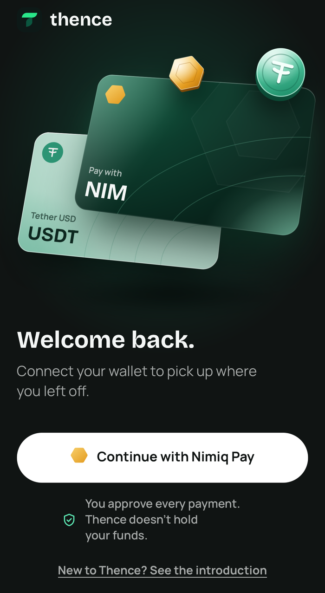
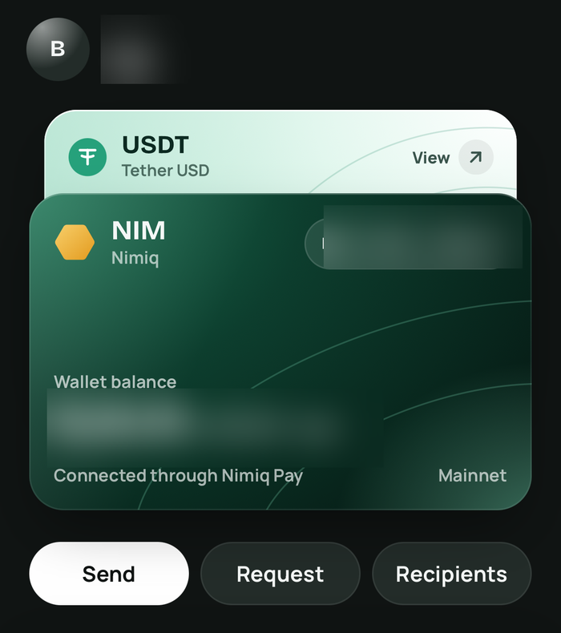
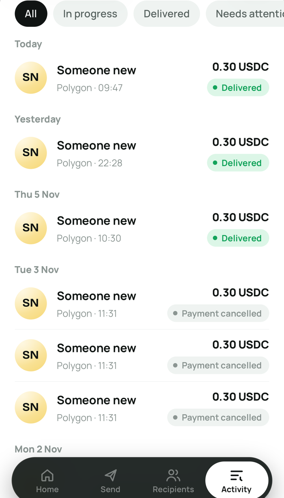
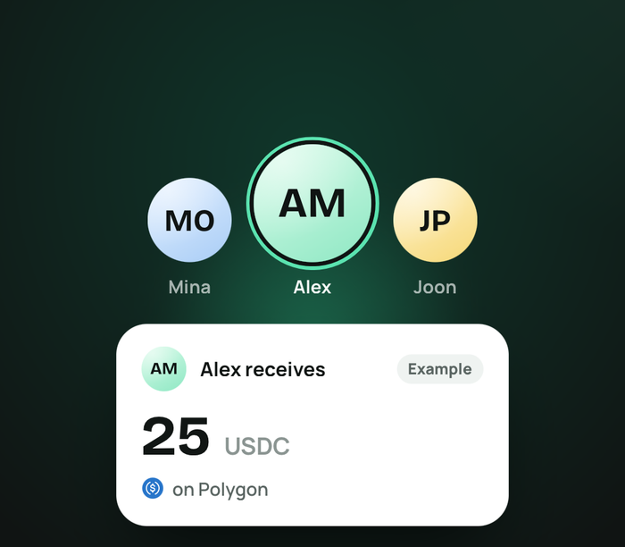
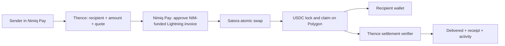

<div align="center">
  
  <h1>thence</h1>
  <h3>Your NIM can go further.</h3>
  <p><strong>Cross-chain payments, powered by Nimiq.</strong></p>
  <p>Pay with NIM. Your recipient gets paid in a supported asset on another blockchain.</p>
  <p>
    <a href="https://paywiththence.cv"><strong>Try Thence</strong></a> ·
    <a href="https://x.com/usethence">Project updates</a> ·
    <a href="docs/hackathon/EVIDENCE.md">Payment evidence</a> ·
    <a href="docs/ARCHITECTURE.md">Architecture</a>
  </p>
  <p><code>Nimiq Cycle 3 Mini App Competition</code> · <code>Pay category</code> · <code>Live mainnet payments</code> · <code>MIT licensed</code></p>
</div>

---

## The problem: your money shouldn't stop at your blockchain

Imagine holding **NIM** but needing to pay someone who uses **USDC on Polygon**.

The recipient doesn't want to open a Nimiq wallet just to receive a payment. You shouldn't have to become an expert in swaps, bridges, networks, fees and wallet compatibility to pay them.

That's the gap Thence is built to close: **let the sender pay with what they hold and let the recipient receive an explicitly supported asset on the chain they use.**

Thence is a **recipient-first payment mini app inside Nimiq Pay**. Instead of making users complete a standalone swap and then figure out the transfer, Thence starts with the person being paid, the destination wallet and the amount they should receive.

**Available today:** NIM in Nimiq Pay → **USDC on Polygon**. Other assets and destinations are planned, **not live**.

## See the actual app

<table>
  <tr>
    <td width="33%" align="center"></td>
    <td width="33%" align="center"></td>
    <td width="33%" align="center"></td>
  </tr>
  <tr>
    <td align="center"><strong>01 · Connect</strong><br/>Continue with Nimiq Pay</td>
    <td align="center"><strong>02 · Pay</strong><br/>NIM wallet and receiving route</td>
    <td align="center"><strong>03 · Verify</strong><br/>Delivery history and status</td>
  </tr>
</table>

<p align="center"><em>Real Thence screenshots from mobile testing. Wallet details in the second image are blurred for privacy. Payment history includes both delivered and cancelled attempts; it is not a fabricated success screen. The USDT card in the app art is a planned asset, not a live route: today the recipient receives <strong>USDC on Polygon</strong>.</em></p>

<details>
<summary><strong>More product UI: recipient-first payment experience</strong></summary>
<br/>
<p align="center"></p>
<p align="center"><em>In-app illustration, not a second live asset or a different route.</em></p>
</details>

> **Judge shortcut:** [Open the working mini app](https://paywiththence.cv) in **Nimiq Pay**. Then see [independent payment evidence](docs/hackathon/EVIDENCE.md), [technical architecture](docs/ARCHITECTURE.md), and [tests](#run-it-locally--verify-the-code).

## Where we saw the problem — before building

This was not a problem invented for a hackathon. We looked at discussions in the Nimiq ecosystem and at the practical friction created when the asset someone owns differs from the asset/network someone else accepts.

| Evidence from the ecosystem | What it told us | The Thence response |
|---|---|---|
| [Nimiq forum: *The Future of Nimiq* (May–June 2025)](https://forum.nimiq.community/t/the-future-of-nimiq/2255) includes community discussion of confusing multi-chain stablecoin transfers, network incompatibilities and the wish for simpler handling. | Token names alone aren't enough. The receiving **network** matters, and cross-chain steps create friction for regular users. | Recipient-first destination selection, a live quote, explicit asset/network labeling, and a single payment journey. |
| [Nimiq Pay roadmap discussion (November 2025)](https://forum.nimiq.community/t/community-question-can-a-more-detailed-roadmap-be-shared-for-nimiq-pay/2366) describes EVM support and payment-aware swap mini-apps as directions to explore. | Extending real wallet utility through mini apps fits a stated ecosystem direction. | Build **inside Nimiq Pay**, using its real wallet and payment SDK rather than a standalone demo wallet. |
| [Nimiq's earlier USDC/Polygon testing thread (March 2023)](https://forum.nimiq.community/t/testing-usdc-support-in-the-nimiq-wallet/1878) shows that NIM/USDC swapping was already possible in the ecosystem. | The innovation is **not claiming to invent swaps**. The opportunity is to turn conversion plus sending into a payment-oriented experience. | Start with what the recipient must receive, authorize once in Nimiq Pay, follow delivery, and keep the receipt. |
| [Cycle III's Pay category](https://miniappscompetition.com/cycle3) asks builders to extend how people use NIM and USDT to pay. | The bar is an app someone can actually use, not another conceptual bridge diagram. | Ship a working mainnet payment route with recovery, status, and on-chain verification. |

**Evidence standard:** These public discussions are *problem/market signals*, not interviews with Thence customers or proof of product-market fit. Thence's own evidence is a separate question: **did a real NIM-funded payment reach a recipient's Polygon wallet?** Yes; see the next section.

## How Thence solves it

1. **Choose the recipient and exact receiving amount.** Set a Polygon wallet and the amount of USDC to deliver; save recipients for later or generate a shareable payment request.
2. **Review the live quote.** Thence requests an exact-receive route quote, shows the payment terms and expiration, and won't invent a price when a live quote is unavailable.
3. **Approve in Nimiq Pay.** The sender authorizes the NIM-funded Lightning payment through the real Nimiq Pay wallet.
4. **Finish delivery once.** An atomic swap via Satora funds the Polygon side. Thence waits through required funding checks and guides the one-tap claim to the recipient's wallet.
5. **Verify and keep proof.** Thence only marks the payment **Delivered** after verifying the USDC transfer at Polygon finality; the activity timeline and receipt keep the result accessible.

**No manual bridge or exchange account for the sender.** The app coordinates the supported route behind the scenes. This does **not** mean every network is available or that a payment has zero fees.

## Real payments. Real proof.

The proof is the transaction reaching a recipient — not merely a green status label.

| What has been verified | Evidence |
|---|---|
| **Mainnet payment, Nov 5, 2026** | A Nimiq Pay-funded transfer delivered at least the intended **0.30 USDC** on Polygon. The original payment was verified after **256 confirmations**, the conservative policy used then. [Pilot report](docs/PILOT_2026-11-05_FIRST_DELIVERY.md). |
| **Public payment, Nov 6** | The first public-mode payment, served from the live Hermes-hosted app, delivered at least the 0.30 USDC target on Polygon, also verified after **256 confirmations** (before the finality change). [Evidence log](docs/hackathon/EVIDENCE.md). |
| **Faster settlement, Nov 7** | Production uses Polygon's `finalized` block tag after the claim (with fail-closed guards), replacing the previous eight-minute confirmation wait. [Finality tests and RPC evidence](docs/POLYGON_FINALITY.md). |
| **User experience** | One **Finish delivery** tap automatically handles the 32-confirmation funding gate. The expected approval-to-Delivered time is around **two minutes**, depending on network/provider conditions; it is not an instant-settlement guarantee. |
| **Verification and controls** | On-chain ERC-20 transfer check, recorded delivery proof, refund/reconciliation handling, payment-mode controls and database emergency stop. [Architecture](docs/ARCHITECTURE.md) · [Security review](docs/SECURITY_REVIEW.md). |

Payment hashes and personal recipient addresses are not published here. This README describes the verifiable process and links to the internal evidence documentation without publishing unnecessary personal wallet data. A successful test payment is not a guarantee that every future payment will complete without delays.

### Reliability evidence behind the release

| Check | Result |
|---|---|
| Polygon finalized-mode integration shards (PR #47) | **515 + 78 + 145 + 216 tests passed** locally, including finalized-mode regression checks ([details](docs/POLYGON_FINALITY.md#verification-2026-11-07-local-github-actions-blocked-by-billing)) |
| Browser E2E against a production build (PR #47) | **21 passed, 0 failed** across Chromium desktop/mobile and WebKit/iPhone; providers/chain simulated |
| Final onboarding polish (PR #53) | **11/11 entry/onboarding tests**, typecheck, lint and production build passed |
| Latest Hermes production rollout | **17/17 read-only checks passed**; health and database reachable; reconciler completed without errors |

These are separate pieces of evidence: simulated end-to-end tests demonstrate expected application behavior; **real mainnet payments** demonstrate actual transfer delivery. Neither is being presented as the other.

## Why this matters for Nimiq

Thence extends the **usefulness of holding and paying with NIM**: a Nimiq Pay user can make a payment to someone who doesn't use Nimiq, using the first supported USDC-on-Polygon route.

The recipient doesn't have to switch wallets. The sender sees the payment they are approving and a record of the outcome. That makes Thence relevant to people paying freelancers, friends or small service providers in a different crypto ecosystem — **a use case**, not a claim of measured adoption by those groups yet.

### Real Nimiq Pay integration

| Mini Apps SDK capability | What Thence does | Implementation |
|---|---|---|
| `init()` | Connect to the injected Nimiq Pay provider | [`src/ui/lib/nimiq-provider.ts`](src/ui/lib/nimiq-provider.ts) |
| `listAccounts()` | Select the payer's wallet | [`src/ui/lib/wallet-diagnostics.ts`](src/ui/lib/wallet-diagnostics.ts) |
| `sign()` | Wallet-backed authentication | [`src/ui/lib/auth-client.ts`](src/ui/lib/auth-client.ts) |
| `getBalance()` | Show NIM funds on Home | [`src/ui/lib/balance.ts`](src/ui/lib/balance.ts) |
| `payLightningInvoice()` | Pay the authorized swap invoice with NIM | [`src/ui/lib/nimiq-pay.ts`](src/ui/lib/nimiq-pay.ts) |

This is wallet/payment infrastructure used in the actual transaction path — not merely Nimiq branding.

## What works today vs. what's next

| Feature or route | Status |
|---|---|
| Connect and sign in with Nimiq Pay; view NIM balance | **Live** |
| NIM → USDC on Polygon, with live quote and payment approval | **Live** |
| Saved recipients and shareable payment requests | **Live** |
| One-tap Finish delivery, progress, activity history, receipts and Polygon proof | **Live** |
| Refund/reconciliation monitoring and emergency controls | **Implemented and active** |
| USDT delivery and additional networks such as Arbitrum, Base and Ethereum | **Coming soon — not enabled in production** |

We will only mark a new route live when it has been validated with real settlement and appropriate safety controls. The Mini App framework's network support should not be confused with routes already supported by **Thence**.

## Technical architecture



The application is built with **Next.js 16, React 19, TypeScript, PostgreSQL/Drizzle**, the **Nimiq Mini Apps SDK**, **Satora**, and **viem**. Money amounts use bigint atomic units; server-side checks bind destination, chain, token and amount before claim authorization. Swap secrets remain on the user's device, and Thence doesn't operate a deposit wallet holding customer funds.

For the full state machine, trust boundaries and refund/recovery path, read [the architecture document](docs/ARCHITECTURE.md).

## Run it locally & verify the code

**Prerequisites:** Node.js 20+, PostgreSQL 16+ ([setup guide](docs/LOCAL_DB.md)). Use a **separate development database**; never point local scripts at production.

```bash
git clone https://github.com/kaelah971/thence.git
cd thence
npm install
cp .env.example .env
# Configure a development PostgreSQL database as documented in docs/LOCAL_DB.md
npm run db:migrate
npm run dev
```

`http://localhost:3000/api/health` is the local health endpoint. For the real wallet experience, open the app inside Nimiq Pay through a properly configured HTTPS origin. Without Nimiq Pay, `/app/preview` is a clearly labeled **fictional, development-only** walkthrough (not real-payment evidence; it does not exist in production).

```bash
npm run typecheck
npm run lint
npm test                 # requires isolated THENCE_TEST_DATABASE_URL
npx playwright test      # browser E2E with simulated Nimiq Pay/Satora/Polygon
npm run build
```

Automated E2E tests use **simulated providers**, while the mainnet deliveries described above are separate, real-payment evidence. Latest verified local release checks also passed with production-health and reconciliation checks. GitHub Actions can be blocked by account billing; **do not interpret an unavailable CI badge as a passing run**.

## Safety, limits and transparency

- **Supported route:** only `usdc-polygon` is live. Other network selectors are labeled **Coming soon**.
- **Payment approval:** Nimiq Pay asks the sender to authorize the NIM-funded invoice; Thence never silently initiates a payment.
- **Time-sensitive handoff:** the sender needs to finish the delivery claim before its deadline (roughly an hour in the current flow). Refund paths and monitoring exist, but provider/network failures may delay resolution.
- **Finality:** since 2026-11-07, production verifies Polygon `finalized` blocks (the Nov 5 and Nov 6 payments used 256 confirmations); the separate 32-confirmation funding gate before Finish delivery is unchanged. Inconsistent or unavailable RPC data does **not** become a false Delivered state. The old 256-confirmation rule remains the default fallback without the production override.
- **Privacy:** avoid posting recipient addresses, secrets, invoice details or full transaction logs publicly. App screenshots above redact private balance/account details.
- **Legal:** [Privacy Policy](docs/legal/PRIVACY_POLICY.md) and [Terms](docs/legal/TERMS_OF_USE.md) are drafts, not legal advice or finalized legal review.
- **Scope:** this is a live, currently narrow payment route — not a claim to support every cryptocurrency, every blockchain, instant settlement, or fee-free transfers.

Security details: [`docs/SECURITY_REVIEW.md`](docs/SECURITY_REVIEW.md) · [`docs/PUBLIC_RELEASE_AUDIT.md`](docs/PUBLIC_RELEASE_AUDIT.md) · [`docs/RISK_IOS_WEBVIEW_STORAGE.md`](docs/RISK_IOS_WEBVIEW_STORAGE.md).

## Competition & further reading

Built for the **[Nimiq Mini Apps Competition — Cycle III](https://miniappscompetition.com/cycle3)**, in the **Pay** category.

- [Official competition rules](https://miniappscompetition.com/rules) — public MIT code, usable app and real Nimiq Pay integration.
- [Judging criteria](https://miniappscompetition.com/scoring) — functionality, usefulness, Nimiq integration, real usage, UX and community engagement.
- [Capability-by-capability evidence](docs/hackathon/EVIDENCE.md) — production vs. tested vs. disabled.
- [Payment recording checklist](docs/hackathon/RECORDING_CHECKLIST.md).
- [Operations and deployment](docs/OPERATIONS.md).

**Thence — Your NIM can go further.**

---

Licensed under [MIT](LICENSE). Third-party frameworks and artwork retain their respective licenses; see [NOTICE](NOTICE.md).
