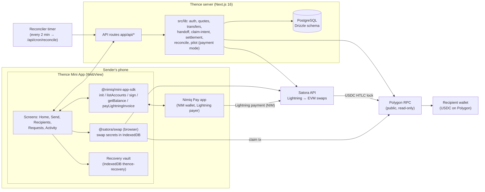
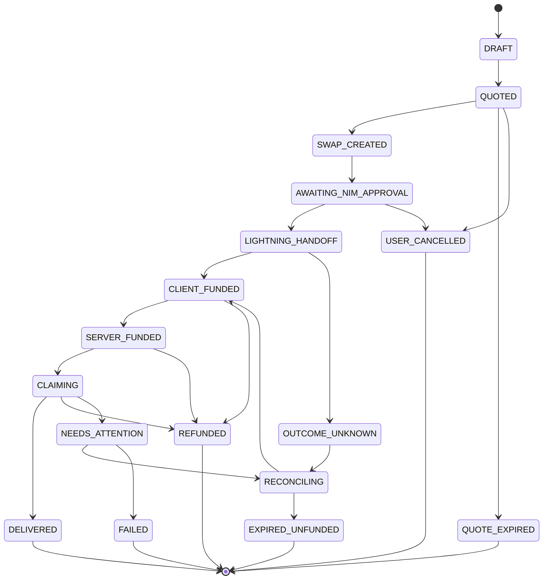

# Thence architecture

This document describes the system as it stands at `main` (November 2026). For each area, the
code under `src/` is authoritative; this document points to it.

## 1. Components

**Custody boundary.** Thence never holds funds or swap secrets:

- NIM leaves the sender's Nimiq Pay wallet through the host's own Lightning payment.
- The swap's preimage and keys are generated and kept by the Satora SDK in the browser.
- The server sees only public facts: the swap id, the invoice, the payment hash, amounts and
  addresses. It re-verifies them read-only.

## 2. Payment lifecycle (transfer state machine)

The state machine is in `src/domain/transfers.ts`. Every transition is written to
`transfer_transitions` with an actor, a reason code and evidence.

The diagram is simplified. The authoritative table is `ALLOWED_TRANSITIONS` in
`src/domain/transfers.ts`.

| Step | Endpoint | Guarantee |
|---|---|---|
| Quote | `GET /api/quotes`, `POST /api/transfers` | Exact-receive. The target is stored in atomic units and bounded by the provider minimum and maximum. |
| Prepare | `POST /api/transfers/:id/prepare` | The device stores a recovery binding and reads it back before continuing. |
| Attach | `POST /api/transfers/:id/attach` | The server re-checks the Satora swap: same amount, destination, token and chain. |
| Authorize | `POST /api/transfers/:id/authorize-handoff` | A single handoff authorization per transfer, behind the payment mode and the emergency switch. |
| Host payment | `payLightningInvoice` (client) | Called once, with the byte-identical authorized invoice. |
| Claim | `POST /api/transfers/:id/claim-intent` | A lease prevents double claims; the claim deadline is enforced. |
| Settle | `POST /api/transfers/:id/verify-settlement` | ERC-20 `Transfer` to the recipient ≥ target, with 256 Polygon confirmations. |
| Reconcile | `/api/transfers/:id/reconcile`, `/api/cron/reconcile` | Provider status and chain observations. Read and verify only: the reconciler never claims or pays. |

## 3. Safety controls

- **Payment mode** `THENCE_PAYMENTS_MODE` (`src/lib/pilot.ts`): `off | pilot | public`. If the
  variable is missing or invalid in production, the mode is `off`.
- **Emergency switch** `pilot_controls.enabled`: a database row, effective on the next request.
  Recovery, claims and refunds keep working when it is off.
- **Exposure:** one unresolved funded payment per user.
- **Rate limits:** Postgres fixed-window counters (`src/lib/rate-limit.ts`). Authenticated
  callers are keyed by user id; anonymous callers are keyed by client IP, and those rows are
  deleted after one hour.
- **Database guard:** `scripts/assert-nonprod-db.ts` refuses dev, migrate and start against
  production. The test database is checked by anchor proof (`tests/ci-verify-test-db.ts`).

## 4. Data model

The main tables, all in `src/db/schema.ts`:

| Table | Purpose |
|---|---|
| `users` | Nimiq address and optional display name |
| `auth_challenges`, `sessions` | Sign-in challenges; sessions store only a SHA-256 token hash |
| `recipients`, `recipient_destinations`, `recipient_verifications` | Address book and wallet-ownership proofs |
| `payment_requests` | Shareable request links |
| `transfers`, `transfer_transitions` | Payments and their audit trail |
| `handoff_attempts`, `swap_attachments` | Bound swaps and the single authorization |
| `reconciliation_observations`, `transfer_proofs` | Provider and chain evidence |
| `pilot_controls`, `job_leases`, `route_observations`, `auth_rate_limits` | Operations |

## 5. Deployment

- **Current:** Vercel serves the app and Neon provides PostgreSQL. A Hermes systemd timer calls
  `/api/cron/reconcile` every 2 minutes (`ops/hermes/`).
- **In progress:** self-hosting on a VPS behind a Cloudflare named tunnel (`ops/selfhost/`). The
  app binds to loopback only, with a proxy-safe origin check.
- **Runbooks:** `docs/OPERATIONS.md`, `docs/PUBLIC_PAYMENTS.md` and `docs/SERVER_RECONCILER.md`.

## 6. Testing strategy

- **Unit tests:** pure domain code, such as money math, transitions and payment mode.
- **Live-handler integration:** the browser API client is dispatched to the real route handlers
  against an isolated Postgres test database, with Satora mocked
  (`setSatoraFetchersForTests`).
- **Browser E2E (Playwright):** Chromium and WebKit run a real production build with a simulated
  Nimiq Pay host, Satora and Polygon (`e2e/`).
- **Mainnet:** one supervised delivery (`docs/PILOT_2026-11-05_FIRST_DELIVERY.md`).
