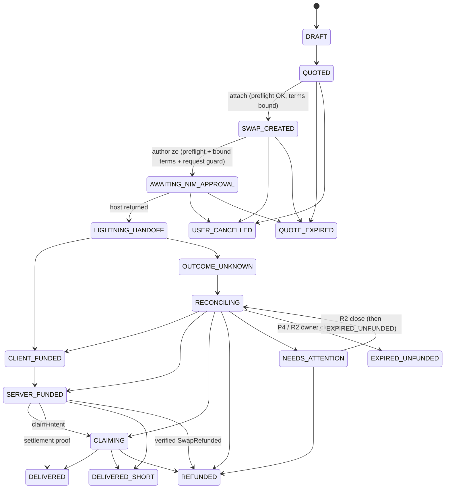
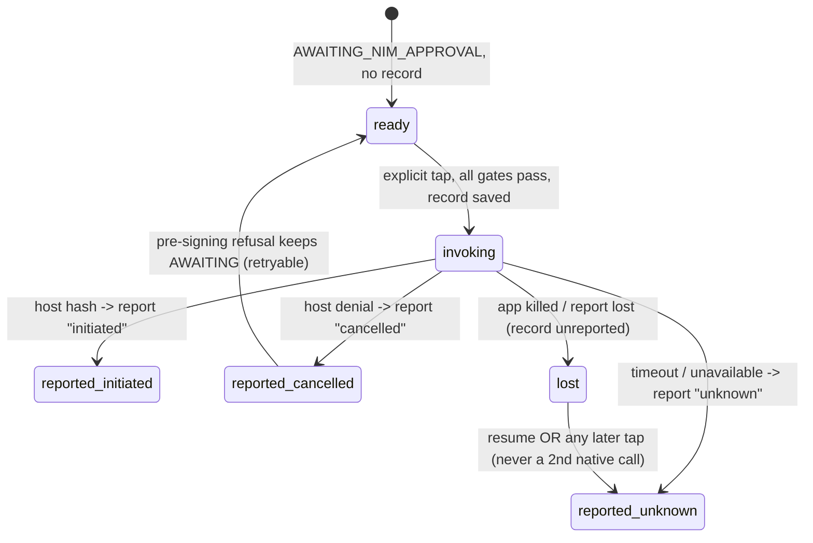

# Thence state-machine atlas

Status: 2026-11-16, branch `fix/arbitrum-htlc-v6-trust` (PR #83), commits
`59d87a7`, `0ca0b9c`, `0002e13`, `d70c2ab`. It describes the code **as
implemented**, not a redesign. Where implementation and intent disagreed, the
disagreement is in the defect register (§21) with its current status.

Thence moves value across systems it does not control (Nimiq Pay, Fastspot,
Lightning, Satora, Polygon/Arbitrum, the browser) and one it does (its
database). The worst incidents so far happened at the **boundaries** between
those systems, so §19 (boundary matrix) and §20 (invariants) matter more than
any single diagram.

Per machine: **SoT** = source of truth; **Writers** = the only code that
changes it; **Exit** = how each non-terminal state eventually leaves.

---

## 0. Inventory and reconciliation

20 machines (E = explicit state field / enum; I = implicit, derived from
fields, timers, leases or external evidence; X = external, modelled from public
contract and observed evidence only).

| # | Machine | Kind | SoT | Owning files |
|---|---|---|---|---|
| M1 | Transfer lifecycle | E | `transfers.status` + `transfer_transitions` | `src/domain/transfers.ts`, `src/lib/transitions.ts` |
| M2 | Quote, reprice, route availability | I | `transfers.quote_*`, env, provider reference data | `src/lib/quotes.ts`, `src/lib/satora.ts`, `src/domain/routes.ts`, `src/lib/env.ts`, `src/ui/screens/send/useLiveQuote.ts` |
| M3 | Preparation run (browser) + handoff attempt (server) | E+I | `handoff_attempts.status`, `swap_attachments`, run generation | `src/lib/handoff.ts`, `src/ui/lib/prepare-flow.ts`, `src/ui/screens/send/usePreparation.ts` |
| M4 | Pre-handoff HTLC preflight + bound terms | I (gate) | live provider read, `HTLC_DEPLOYMENTS`, SWAP_ATTACHED audit row | `src/lib/htlc-preflight.ts`, `src/lib/settlement.ts` |
| M5 | Nimiq Pay invocation + handoff report | I | browser handoff record (localStorage) + `transfers.status` | `src/ui/screens/send/useHandoff.ts`, `src/ui/lib/nimiq-pay.ts`, `src/ui/lib/payment-gate.ts`, `src/ui/lib/handoff-client.ts`, `app/api/transfers/[id]/handoff-result` |
| M6 | NIM source evidence + Nimiq HTLC (X) | I/X | `transfer_source_evidence`, transition evidence, Nimiq chain | `src/lib/nimiq-source.ts`, `src/lib/handoff-stall.ts` |
| M7 | Satora swap status | X | provider `GET /swap/:id` | `src/lib/satora.ts`, `src/domain/provider-status.ts` |
| M8 | EVM HTLC lifecycle + finality | X | chain (finalized) | `src/lib/settlement.ts` |
| M9 | Claim authorization (server) + execution (browser) | E+I | `job_leases` `claim:<id>`, `transfers.status`, browser claim record | `src/lib/claim-intent.ts`, `src/ui/lib/claim-gate.ts`, `src/ui/screens/send/useSettlement.ts`, `src/ui/lib/satora-browser.ts` |
| M10 | Settlement verification / delivery / short delivery | E | `transfer_proofs`, transitions | `src/lib/settlement.ts` |
| M11 | Reconciliation core + planner | E | `reconciliation_observations`, transitions | `src/lib/reconcile.ts` |
| M12 | Server reconciliation scheduling | I | `job_leases` (reconciler), observations | `src/lib/server-reconciler.ts`, `app/api/cron/reconcile` |
| M13 | Refund recognition + expiry / NIM-return closes | E (gated) | chain + Nimiq node + local history | `src/lib/reconcile.ts`, `src/lib/expiry-resolution.ts` (P4), `src/lib/nim-return-resolution.ts` (R2), `src/lib/close-eligibility.ts` |
| M14 | Pilot / exposure / kill switch | I | env + `pilot_controls` + derived exposure | `src/lib/pilot.ts` |
| M15 | Client tracking, progress and recovery view | I | server reads only | `src/ui/lib/payment-tracker.ts`, `payment-progress.ts`, `recovery-state.ts`, `settlement-client.ts`, `src/ui/screens/activity/Activity.tsx` |
| M16 | Session, onboarding, device storage | E+I | `sessions`, `auth_challenges`, browser storage | `src/lib/auth.ts`, `src/ui/lib/session.ts`, `stores.ts`, `onboarding-flow.ts`, `resource.ts` |
| M17 | Recovery vault (browser) | I | IndexedDB (SDK `lendaswap-v3` + vault) | `src/ui/lib/recovery-vault.ts`, `satora-browser.ts` |
| M18 | Recipient destination verification + address book | E | `recipient_verifications`, `recipient_destinations` | `src/lib/verification.ts`, `src/lib/recipients.ts` |
| M19 | Payment request | I (derived) | `payment_requests` + linked `transfers` | `src/lib/requests.ts`, `src/lib/request-payment.ts` |
| M20 | Proof publication | I (derived) | `transfer_proofs`, source evidence | `src/lib/global-proofs.ts`, `src/lib/historical-proof-recovery.ts` |

Operational (outside the payment code): deployment/rollback
(`ops/selfhost`), rate limiting (`src/lib/rate-limit.ts`), price display cache
(`src/lib/nim-price.ts`). Listed in §18; not financial state machines.

### Reconciliation with the independent 36-candidate draft

The owner-supplied static draft (36 candidates) and this atlas cover the same
ground; the draft explicitly invited merging/splitting by ownership. Mapping:

| Draft # | Draft name | Here | Why merged / kept |
|---|---|---|---|
| 01 | Canonical transfer lifecycle | M1 | same |
| 02 | Quote freshness and repricing | M2 | same |
| 03 | Route eligibility | M2 + M4 | "enabled" is M2; "safe to hand off" is M4 |
| 04 | Pilot / exposure / kill switch | M14 | same |
| 05 | Preparation orchestration | M3 | browser run is the client half of the attempt machine |
| 06 | Handoff attempt lifecycle | M3 | same authority (server attempt row) |
| 07 | Provider swap create/store crash window | M3 + M17 | an orphaned swap cannot be paid: authorize requires attach, attach requires vault+SDK readback |
| 08 | Recovery vault binding | M17 | same |
| 09 | Native Nimiq Pay invocation | M5 | same |
| 10 | Client handoff reporting and resume | M5 | same authority (handoff record + server status) |
| 11 | NIM source evidence | M6 | same |
| 12 | Satora provider state | M7 | same |
| 13 | HTLC deployment compatibility | M4 | same |
| 14 | EVM HTLC lifecycle | M8 | same |
| 15 | Funding verification and finality | M8 + M9 | verifiers live in M8, consumed by M9 |
| 16 | Claim authorization and lease | M9 | server half |
| 17 | Browser claim execution and L1 wait | M9 | client half; one authority (lease) |
| 18 | Destination proof and delivery | M10 | same |
| 19 | EVM refund recognition | M13 | refund recognition is the reconciler's refund gate |
| 20 | Nimiq HTLC early/timeout return | M6 + M13 | external lock (M6), Thence's proof and close (M13) |
| 21 | Expired-unfunded closure | M13 | P4 and R2 share gates |
| 22 | Reconciliation core / planner | M11 | same |
| 23 | Background reconciliation scheduling | M12 | same |
| 24 | Browser payment tracker | M15 | same |
| 25 | Activity five-kind recovery | M15 | same |
| 26 | Request-to-pay lifecycle | M19 | same (now with derived paid state) |
| 27 | Recipient verification challenge | M18 | same |
| 28 | Saved recipient/destination | M18 | address book is the challenge's subject |
| 29 | Authentication session | M16 | same |
| 30 | Onboarding / wallet setup | M16 | device-state routing only |
| 31 | Browser API resource cache | M16 | keyed by user; verified, no defect (§16) |
| 32 | Public proof publishing | M20 | same |
| 33 | Price estimate cache | §18 | display-only, never executable |
| 34 | API rate limiting | §18 | budget, no financial state |
| 35 | Handoff stall detection | M6 | derived display/alert condition, no state |
| 36 | Deployment / release rollback | §18 | operational |

No draft candidate was found to be a missing financial machine. Two
**boundary** behaviours the draft did not list were found during code tracing
and are now fixed: duplicate Nimiq Pay invocation after a lost response
(D12) and the settlement terms not being bound at attach (D13).

---

## 1. M1 Transfer lifecycle (canonical)

**SoT** `transfers.status`; every write audited in `transfer_transitions` in
the same transaction; at most one terminal row per transfer (unique index).
**Writers** `handoff.ts` (attach, authorize, cancel), handoff-result route,
`reconcile.ts` planner, `claim-intent.ts`, `settlement.ts`,
`expiry-resolution.ts` (P4), `nim-return-resolution.ts` (R2). All use
`canTransition` / `transition()`; DELIVERED and DELIVERED_SHORT assert
destination evidence.



Also legal, omitted for readability: CLIENT_FUNDED / SERVER_FUNDED / CLAIMING
→ OUTCOME_UNKNOWN, NEEDS_ATTENTION, REFUNDED; CLAIMING → FAILED;
NEEDS_ATTENTION → FAILED.

**Forbidden by construction** OUTCOME_UNKNOWN → FAILED; LIGHTNING_HANDOFF
self-loop; DELIVERED without destination evidence; any edge out of a terminal;
regression on stale provider observations (planner walks forward only).

**Terminal** QUOTE_EXPIRED, USER_CANCELLED, REFUNDED, DELIVERED,
DELIVERED_SHORT, FAILED, EXPIRED_UNFUNDED.

**Semantics often misread**
- CLIENT_FUNDED / SERVER_FUNDED are entered from the **provider's status**.
  Funding is verified on-chain only by claim-intent. Copy no longer calls them
  verified (D6).
- REFUNDED = the **provider's EVM lock** returned to the provider, proven by a
  SwapRefunded of the pinned HTLC. It never asserts the user's NIM came back.
- EXPIRED_UNFUNDED via R2 carries a Nimiq-chain proof of the full NIM return;
  via P4 it carries proof that no NIM was ever recorded.

**Exits**

| State | Automatic exit | Owner exit | Dead end? |
|---|---|---|---|
| QUOTED / SWAP_CREATED | — | cancel / retire | no |
| AWAITING_NIM_APPROVAL | handoff-result | cancel (verified no funding) | no |
| LIGHTNING_HANDOFF / OUTCOME_UNKNOWN / RECONCILING | planner on provider status | P4 / R2 | no |
| CLIENT_FUNDED / SERVER_FUNDED / CLAIMING | planner → REFUNDED (trusted HTLC + verified refund); settlement → DELIVERED | Finish delivery | only for an untrusted HTLC; prevented for new payments by M4 (D3) |
| NEEDS_ATTENTION | planner → REFUNDED (refund statuses) | **R2 NIM-return close (new, D4)** | no longer, once NIM is provably returned |

Tests: `transfers`, `reconciliation`, `p5-locking-audit`,
`p5-refund-consistency`, consistency checker across suites.

## 2. M2 Quote, reprice, route availability

States: route `disabled` (not in `THENCE_ENABLED_ROUTES`) →
`enabled-unquoteable` (no pair/token, or token identity mismatch) →
`quoteable`; quote `fresh` → `stale` (local TTL); `quoteRevision` increments on
requote; attempts bind one revision (VERSION_CONFLICT otherwise).

Guards: token identity pinned (`TRUSTED_ROUTE_TOKEN_IDENTITIES`, native USDC
only on Arbitrum); exact-output only; authorize refuses a live source amount
above the quoted one unless the owner accepted that exact figure
(`REPRICED_NEEDS_CONFIRMATION`). Route "enabled" is **not** "safe to hand
off": M4 decides that per swap.

Tests: `quotes`, `quotes-multiroute`, `routes`, `f32-requests-quotes`,
`transfer-intents`, `transfer-handoff` (reprice).

## 3. M3 Preparation run + handoff attempt

Server `handoff_attempts.status`: `PREPARED → SWAP_ATTACHED →
HANDOFF_AUTHORIZED`, or `SUPERSEDED`; expiry computed from `expires_at`; one
active attempt per transfer (partial unique index); bearer token stored hashed.

Browser (`usePreparation`): create (idempotent key) → prepare → Satora SDK
swap → SDK readback + vault save + vault readback → attach
(`recoveryAcknowledged`) → authorize. One run generation; timeout (90 s),
reset and newer runs invalidate it, so a late completion cannot overwrite the
timeout state or unlock a later run (F8.12).

Server steps are P5-shaped: phase A reads without a lock; phase B re-checks
under the per-transfer advisory lock and refuses evidence older than 2 min.

Crash windows: provider created the swap but the browser died → the swap is
never attached, so it can never be authorized or paid; attach response lost →
idempotent replay returns the same binding; authorize double-click →
`ALREADY_AUTHORIZED` (status-guarded single update).

Tests: `transfer-handoff`, `f41-prepare-flow`, `f41-recovery-vault`,
`f812-attach-recovery`, `f812-retire-replace`, `f811-hang-guard`,
`f81-pilot-attempt-limits`.

## 4. M4 Pre-handoff preflight and bound terms

Not stored state: gates on a **fresh provider read** at attach and at
authorize, the last step before the invoice is released to Nimiq Pay.

At attach and authorize (`htlcPreflight`), refuse unless:
- `(chain, evm_htlc_address)` is pinned and the declared `evm_htlc_version`,
  `evm_htlc_kind` and `evm_coordinator_address` equal that pinned tuple
  (`HTLC_UNSUPPORTED`);
- lock token, amount (> 0), refund and claim addresses (distinct), hash lock
  and deadline are present (`HTLC_TERMS_INCOMPLETE` / `HTLC_TERMS_MISMATCH`);
- deadline − now ≥ runway: Polygon 15 min, Arbitrum 35 min (~20 min L1
  finality) (`HTLC_DEADLINE_TOO_CLOSE`).

Attach records the bound terms (chain, HTLC address, version, kind,
coordinator, lock token, lock amount, refund and claim parties, route token) in
the SWAP_ATTACHED audit row, same transaction as the binding. Authorize
additionally refuses when the fresh read differs from them
(`HTLC_TERMS_MISMATCH`; no record → `HTLC_TERMS_INCOMPLETE`), or from the bound
invoice, swap id, destination amount and address, or direction
(`SWAP_MISMATCH`). Source-amount changes stay with the reprice guard.

Pinned deployments (on-chain: EIP-712 domain separator per version, chain and
address; coordinator bytecode embeds exactly its HTLC):

| Chain | HTLCErc20 | Version | Coordinator |
|---|---|---|---|
| 137 | `0xf12a…3948` | 6 | `0xdb76…bff0` (v4) |
| 42161 | `0x6c38…6748` | 7 | `0xb791…b71f` (v5) |
| 42161 | `0xf12a…3948` | 6 | `0xdb76…bff0` (v4) |

Polygon v7 is deployed (5,862 bytes at `0x6c38…` on Polygon, observed
2026-11-16) but deliberately **not** trusted: no Polygon v7 settlement has been
verified end to end, and its domain separator / coordinator pairing on Polygon
was not checked in this session (D9).

Tests: `arbitrum-incident-af9dc922`, `arbitrum-htlc-v6-trust`,
`transfer-handoff` (7 drift cases), `p2-claim-deadline`, `a3a`.

## 5. M5 Nimiq Pay invocation and handoff report



The client can only report `initiated | cancelled | unknown`; never funding
(`CLIENT_CANNOT_ATTEST`). Gates before a native call: payment flag, host
capability and network, session, AWAITING_NIM_APPROVAL, vault binding = bound
swap, live invoice, explicit action, **no unreported record for this invoice**
(D12). One in-flight call per hook (`inflight` ref).

Residual risk (external): on a **different device** the local record does not
exist. A second device could pay the same invoice while the first's response
is lost; Lightning's hold invoice accepts one payment, so the duplicate fails
at the Lightning layer and Fastspot's NIM lock for it returns at its timeout.

Tests: `f42-handoff`, `f45-nimiq-pay-failure-reasons`,
`ui-lightning-handoff-progress`, `r4-host-swap-id`.

## 6. M6 NIM source evidence and the Nimiq HTLC

External Nimiq HTLC: `funded → redeemed (preimage) | TimeoutResolve to owner
after timeout | EarlyResolve co-signed`. Thence records the host hash as a
**hint**, verifies the HTLC creation (hash lock = bound payment hash, owner
address, amount, finality) and appends the verdict. It never acts on the NIM.
R3 derives a "stalled handoff" alert from verified source + provider still
`pending` past a threshold (no state change).

Tests: `nimiq-source`, `r2-nimiq-htlc-return`, `r3-handoff-stall`.

## 7. M7 Satora swap status (external)

Official model: `pending → clientfunded → serverfunded → clientredeemed →
serverredeemed`; refunds `clientfunded → clientrefunded`, `serverfunded →
clientfundedserverrefunded`; errors `clientinvalidfunded`,
`clientfundedtoolate`, `serverwontfund`, `clientrefundedserverfunded`;
`expired`; mixed `clientredeemedandclientrefunded` (EVM **redeemed**, BTC side
refunded to the client).

One classification (`src/domain/provider-status.ts`):

| Set | Members | Consequence |
|---|---|---|
| CLAIM_ACTIVITY | clientredeeming, clientredeemed, serverredeemed, clientredeemedandclientrefunded | planner → CLAIMING; DELIVERED still needs chain proof |
| PROVIDER_REFUND | clientrefunded, clientfundedserverrefunded, clientrefundedserverfunded, clientrefundedserverrefunded | REFUNDED only after a verified SwapRefunded |
| refused-to-fund | clientinvalidfunded, clientfundedtoolate, serverwontfund | NEEDS_ATTENTION; R2 exit with NIM proof |
| `expired` | — | no transition; P4/R2 owner close |

Field names are not evidence: Satora reported its **refund** tx in
`evm_claim_txid` (incident af9dc922). That field is a pointer for the refund
verifier and a "do not re-claim" signal for claim-intent; delivery needs
CLAIM_ACTIVITY **and** chain proof.

## 8. M8 EVM HTLC lifecycle and finality (external)

Per SwapKey = keccak(hashLock, amount, token, refund, claim, timelock):
`NONE → ACTIVE (SwapCreated) → REDEEMED (SwapRedeemed) | REFUNDED
(SwapRefunded, after timelock)`; SwapRehashed refused. Polygon: funding ≥ 32
confirmations for a claim, configurable settlement policy. Arbitrum: always
the RPC's L1 `finalized` tag (~20 min), anchored-block reads so a moving head
cannot change a verdict; reorg = block hash change at the receipt height →
INCONCLUSIVE, never a negative verdict.

Every verifier starts with `isTrustedHtlc(chain, address)`: an untrusted HTLC
is INVALID everywhere (root of D3).

## 9. M9 Claim authorization and execution

```mermaid
sequenceDiagram
  participant B as Browser (owner tap)
  participant S as claim-intent
  participant P as Satora
  participant C as Chain
  B->>S: POST claim-intent
  S->>P: fresh read (serverfunded, no claim tx, identity)
  S->>C: funding (finality), lifecycle ACTIVE (Arbitrum), unspent (retry only)
  S->>S: lock, deadline > 5 min, lease claim:<id> (10 min)
  S-->>B: SERVER_FUNDED -> CLAIMING
  B->>P: SDK gasless claim (ERC-4337 sponsored; preimage never to Thence)
  B->>S: verify-settlement (poll)
```

One live lease per transfer across tabs/devices; a retry needs the lease
expired AND the chain proving the lock unspent AND the provider showing no
claim. Unknown claim outcome stays CLAIMING; reconciliation and
verify-settlement decide. The HTLC redeems once, so a duplicate claim can only
revert, never deliver twice.

Execution differs per chain (f1ca0926, D15/D16). Polygon: Satora's gasless
relay (`POST /swap/:id/claim-gasless`). Arbitrum hub swaps with a DEX leg: the
SDK fetches `/dex-calldata/fund` (approve + Uniswap v3), signs the HTLC Redeem
digest (domain `HTLCErc20`, version 6 or 7), and sends a sponsored ERC-4337
UserOperation (EIP-7702 Kernel v3.3, EntryPoint v0.7, Satora's Alchemy
bundler + Gas Manager policy, pinned in `src/ui/lib/arbitrum-aa.ts`) calling
`coordinator.redeemAndExecute`. The browser classifies each attempt from the
requests it actually made (`src/ui/lib/claim-evidence.ts`):
submitted (UserOperation hash / relay 2xx), not-submitted (no send, or an
explicit refusal), unknown (send without an answer), and reports it
(`claim-report`, annotation row `CLAIM_ATTEMPT_REPORTED`, journal line
`thence claim-report:`). New payments are allowed only on claim paths proven
to deliver (`src/lib/claim-execution.ts`); Arbitrum v6/v7 are unproven.

Tests: `p3-claim-intent`, `p3-claim-verification`, `p7-arbitrum-recovery`,
`ui-p3-claim-completion`, `a3a`, `a3b`, `arbitrum-claim-execution`.

## 10. M10 Settlement verification

SERVER_FUNDED / CLAIMING + CLAIM_ACTIVITY + claim tx → receipt on the route's
chain: success, SwapRedeemed of the pinned HTLC for the bound hash lock (and
SwapKey on Arbitrum), destination Transfer(s) of the canonical token to the
destination, finality. Exact → DELIVERED; 0 < received < requested →
DELIVERED_SHORT (R7); otherwise no transition. Proof row in the same
transaction.

## 11. M11 Reconciliation core

ONE core (`reconcileCore`) for owner route and cron. Phase A: provider read,
route identity, refund evidence (chain I/O, no lock). Phase B: lock, re-read,
identity check (mismatch → observation only), refund gate (`REFUND_<verdict>`
unless VERIFIED), planner, audited path, deduped observation.

## 12. M12 Server reconciliation scheduling

Single-runner lease (5 min TTL, ≥ 30 s spacing), ≤ N transfers in a 45 s
budget, sequential. Due intervals: funded 1 min (2 min after the deadline),
pre-funding 2 min while the invoice is live then 10 min, provider `expired`
6 h, last read failed ≥ 5 min. Priority: open claim windows by soonest
deadline. Only `SERVER_RECONCILABLE` statuses with UUID swap ids. A crashed
run's lease simply expires.

## 13. M13 Refund recognition, expiry and NIM-return closes

Three refunds, never conflated:

| Asset | Where locked | Who returns it | What Thence can prove |
|---|---|---|---|
| Provider's WBTC/tBTC | EVM HTLC | Satora after `evm_refund_locktime` | SwapRefunded → REFUNDED |
| Lightning payment | Satora hold invoice | cancelled when not settled | not observable |
| User's NIM | Nimiq HTLC (Fastspot) | TimeoutResolve to owner, or EarlyResolve | R2 full-return proof → EXPIRED_UNFUNDED |

Owner closes (preview in `close-eligibility.ts` runs the same gates):
- **P4** RECONCILING + provider `expired` + no NIM recorded + no movement +
  finalized no-EVM-activity scan → EXPIRED_UNFUNDED.
- **R2** LIGHTNING_HANDOFF / OUTCOME_UNKNOWN / RECONCILING + provider
  `expired`, or **NEEDS_ATTENTION** + provider `expired` or refused-to-fund
  (client-side movement tolerated, provider EVM movement refused) + finalized
  no-EVM-activity scan + full NIM return proven on the Nimiq chain →
  EXPIRED_UNFUNDED.

## 14. M14 Pilot, exposure, kill switch

Two keys for new funding (env + `pilot_controls.enabled`), allowlist, amount
caps, and **one unresolved payment per owner** (SWAP_CREATED …
NEEDS_ATTENTION count). Exposure is derived from status, so it is released
exactly when a terminal transition commits. Claim and recovery ignore the kill
switch on purpose.

## 15. M15 Client tracking, progress and recovery view

One tracker per (owner, transfer): backoff 3 → 30 s, 15 s cap before funding,
60 s after a 429, no polling while hidden but always wakes on
visible/focus/pageshow/online, stops at terminal statuses, rebuilt from server
state after reload. `payment-progress` and `recovery-state` derive one
headline and one action from server facts. Recovery kinds: preparation /
uncertain / funds-moved / expired-closable / closed. A funded transfer with a
provider refund shows the refund (uncertain) view, never "funded" (D6).

## 16. M16 Session, onboarding, device storage

Server: challenges (expiring, single-use atomic consume) → sessions (hashed
token, expiry, revocation). Client mirrors `/api/me`; a 401 clears the pending
pointer and cached data. Storage: intro hint, setup name, preview mode, pending
pointer (owner-scoped), handoff record (owner-scoped), vault + SDK DB.
Resource cache keys include the user id, aborts on key change and drops late
responses (draft #31: verified, no defect). Missing/corrupt storage stops
before approval; it never creates a new swap.

## 17. M17–M20

- **M17 Recovery vault**: binding (transfer, owner, swap, attempt) saved and
  read back with the SDK's stored swap before attach; a foreign or corrupt
  binding stops the flow.
- **M18 Destination verification**: challenge (bound triple, nonce, expiry) →
  EIP-191 signed by an EOA → `verified_at`; editing the triple clears it; one
  active challenge per destination; single-use token (atomic consume).
- **M19 Payment request**: `open` → `cancelled` (terminal, idempotent) |
  `expired` (clock). Paid state is **derived**: a linked transfer delivered
  (`paid`) or authorized and unresolved (`in-progress`) refuses another payment
  at creation and at authorize under a per-request advisory lock (D5).
- **M20 Proof publication**: publishable only after independent NIM source
  verification and destination proof are committed; one proof row per
  transfer; historical recovery fills gaps read-only.

## 18. Operational, non-financial

- Deployment/rollback (`ops/selfhost`): archive + checksum + activation at a
  clean reconcile boundary; rollback release kept. Code changes here add no
  migration; rollback to the previous release is safe (the bound-terms record
  is an extra JSON key old code ignores; a payment bound under new code and
  authorized under old code is checked by the old, weaker gate only).
- Rate limiting: Postgres windows; 429 → tracker backs off 60 s; never a
  financial outcome.
- NIM price: display-only estimate, never an executable quote.

---

## 19. Boundary matrix

| Disagreement | Authority | Resolving evidence | Blocked meanwhile | Safe eventual outcome |
|---|---|---|---|---|
| Provider says refunded, transfer SERVER_FUNDED, HTLC trusted | chain | SwapRefunded of pinned HTLC for bound SwapKey, finalized | claim (claim-intent sees refund status / claim field) | REFUNDED, audit `nimiqSideRefund: not_observable` |
| Same, HTLC untrusted (incident before #83) | chain, but verifiers refuse | none acceptable | everything | stays SERVER_FUNDED until the HTLC is pinned; prevented for new payments by M4 (D3) |
| Provider-selected HTLC not pinned / misdeclared | Thence pin table | provider declaration vs `HTLC_DEPLOYMENTS` | attach / authorize | refused before Nimiq Pay, no NIM moved |
| Provider terms change between attach and authorize | bound SWAP_ATTACHED record | fresh read vs bound terms | authorize | refused before Nimiq Pay (owner starts again) |
| EVM refunded, NIM still locked | Nimiq chain | TimeoutResolve / EarlyResolve to owner | nothing (REFUNDED is terminal for Thence) | owner refunds in Nimiq Pay after timeout; copy says so |
| Browser reports unknown claim, chain shows refund | chain | SwapRefunded vs SwapRedeemed | retry claim (lease + unspent proof) | REFUNDED; settlement INVALID without SwapRedeemed |
| `evm_claim_txid` holds a refund tx | chain | event identity in the receipt | delivery (needs CLAIM_ACTIVITY + SwapRedeemed + Transfer) | REFUNDED |
| Provider `clientredeemedandclientrefunded` | chain | SwapRedeemed + destination Transfer | — | DELIVERED / DELIVERED_SHORT after proof (D2) |
| Native Nimiq Pay response lost (same device) | Nimiq / Fastspot / provider | provider status, NIM source evidence | a second native call (D12) | reported unknown → reconciliation |
| Native response lost, other device | Lightning hold invoice | — | nothing in Thence | duplicate payment fails at Lightning; NIM lock returns at timeout (external) |
| Claim landed, reconciler crashed before commit | chain | receipt re-found on the next run | nothing written (one transaction) | DELIVERED on the next verify |
| Provider funding seen while RECONCILING | provider (then chain at claim) | provider status | — | direct legal edges onward |
| Provider `expired`, NIM recorded | Nimiq chain | R2 return proof | P4 (cannot prove NIM back) | EXPIRED_UNFUNDED after Nimiq timeout + proof |
| Provider refused to fund (NEEDS_ATTENTION) | Nimiq chain + EVM chain | R2 proof + no-EVM-activity scan | new payments (exposure) | EXPIRED_UNFUNDED (D4) |
| Provider changes deadline after bind | bound attachment | identity check | claim | stays for owner review |
| Request paid / being paid by another payer | Thence DB | linked transfer statuses | create + authorize | refused, request paid once (D5) |
| Satora moves Polygon to v7 | Thence pin table | none until verified | Polygon handoffs (fail closed, visible) | add v7 after independent verification (D9) |

## 20. Invariants (executable)

1. No Nimiq Pay handoff for a swap whose HTLC deployment, terms, bound terms
   and runway are not verified (`arbitrum-incident-af9dc922`,
   `transfer-handoff`).
2. DELIVERED / DELIVERED_SHORT ⇒ destination receipt redeeming the bound swap
   on the route's chain, finality met (`p3-claim-verification`, `r7`, `a3a`).
3. REFUNDED ⇒ SwapRefunded of the pinned HTLC for the bound hash lock (and
   SwapKey on Arbitrum), finality met (`p5-refund-consistency`, incident suite).
4. REFUNDED never asserts a NIM refund (audit `nimiqSideRefund`, copy tests).
5. At most one live claim authorization per transfer (`p3-claim-intent`).
6. Every status write audited in the same transaction; at most one terminal
   transition (`p5-locking-audit`, consistency checker).
7. At most one unresolved funded payment per owner (`a3b`, `f41-prepare-flow`,
   `f812-retire-replace`).
8. At most one payment per payment request, including two concurrent payers
   (`request-single-payment`).
9. Provider statuses and field names never decide an outcome without chain
   evidence (`provider-status.ts`, incident suite).
10. A lost native response is never followed by a second Nimiq Pay call for
    the same invoice (`f42-handoff`).
11. Every non-terminal state has an evidence-gated exit (`r2` D4 cases,
    `recovery-milestone`).

## 21. Defect register

| ID | Sev | Machine / boundary | Evidence | Status |
|---|---|---|---|---|
| D1 | P0 | M4: no check of the provider-selected HTLC before NIM commit | incident af9dc922 (declared v6 at creation) | **fixed** `0ca0b9c` |
| D1b | P0 | M8: Arbitrum v6 untrusted | incident | **fixed** `59d87a7` + pinned tuple `0ca0b9c` |
| D2 | P1 | M7: `clientredeemedandclientrefunded` treated as refund; a real delivery stuck forever | Satora `SwapStatus` docs | **fixed** `0ca0b9c` |
| D3 | P1 | M1↔M8: funded transfer on an untrusted HTLC can never leave SERVER_FUNDED | incident transfer | **prevented** for new payments (D1); the incident transfer exits after #83 is deployed (refund event shape verified in tests) |
| D4 | P1 | M1/M14: NEEDS_ATTENTION had no exit and held the exposure slot | TRANSITIONS + no FAILED writer | **fixed** `d70c2ab` (R2 exit with NIM proof) |
| D5 | P1 | M19: a request could be paid more than once | no derived paid state; Send copy promised it | **fixed** `0002e13` (create + authorize under request lock; concurrency test) |
| D6 | P2 | M15: copy hard-coded Polygon; SERVER_FUNDED called verified; funded + refund shown as funded; refund copy called the lock USDC | recovery-state, settlement-client | **fixed** `0ca0b9c`, `0002e13` |
| D7 | P2 | M7: status sets duplicated in five files | grep | **fixed** `0ca0b9c` |
| D8 | P2 | M3/M4: a swap without a provider deadline could be bound, leaving a funded payment unclaimable | `verifySwapMatch` | **fixed** `0ca0b9c` |
| D9 | P2 | M4: Polygon v7 is Satora's current deployment but untrusted | README + 18 swaps all v6 | **open, external**: fail-closed; needs Polygon v7 domain separator + coordinator pairing + one verified settlement before pinning |
| D10 | P3 | M19: public request page does not show "already paid" | UI only | **deferred** (server refuses) |
| D11 | P3 | M14: pilot header says "usdc-polygon only" though public mode serves Arbitrum | `pilot.ts` header | **deferred** (doc drift) |
| D12 | P1 | M5: second Nimiq Pay call possible after a lost native response | `invoke()` ignored the unreported record | **fixed** `d70c2ab` |
| D13 | P1 | M4: authorize did not compare the fresh read with the invoice / HTLC terms bound at attach | `authorizeHandoff` | **fixed** `0002e13` |
| D14 | P3 | M5: duplicate invocation from a second device or after local-storage loss | handoff record is device-local | **mitigated, residual external**: `invoke()` refuses without a device-local vault binding matching transfer, owner and bound swap, so a second device cannot pay through Thence; authorize is single-use. Residual: invoice copied into another wallet by hand, or localStorage wiped while IndexedDB survives. Both NIM locks would share one hash lock; whether Fastspot would redeem a lock whose own Lightning payment failed is outside Thence's control and unverified |

| D15 | P0 | M9: Arbitrum claim EXECUTION was never proven; only funding was. f1ca0926: claim authorized, browser claim failed with no UserOperation, transaction or provider claim; provider refunded | incident f1ca0926 (2026-11-16) | **open, fails closed**: `CLAIM_PATH_UNPROVEN` refuses new Arbitrum payments (create, bind, authorize); existing transfers unaffected. Exact failing SDK step still unknown (browser-only error; now reported). Promote a path only after a verified live delivery |
| D16 | P1 | M15/M9: any SDK throw shown as "Delivery submitted"; Activity timeline said Polygon for Arbitrum; one transient read ended the finality wait | f1ca0926 screens + journal 17:56/17:57Z | **fixed** this branch: evidence-based submission classification, network-specific copy, transient refusals keep the wait |

**Totals (17 entries).** By severity: P0 3 (D1, D1b, D15); P1 7 (D2, D3, D4, D5, D12, D13, D16); P2 4 (D6, D7, D8, D9); P3 3 (D10, D11, D14).
By status: fixed 11 (D1, D1b, D2, D4, D5, D6, D7, D8, D12, D13, D16); prevented for new payments 1 (D3, the incident transfer exits after deploy); open external 1 (D9, fails closed); open, fails closed 1 (D15); deferred 2 (D10, D11, server already refuses / doc only); mitigated with external residual 1 (D14). One P0 is open (D15) and fails closed for new payments.
